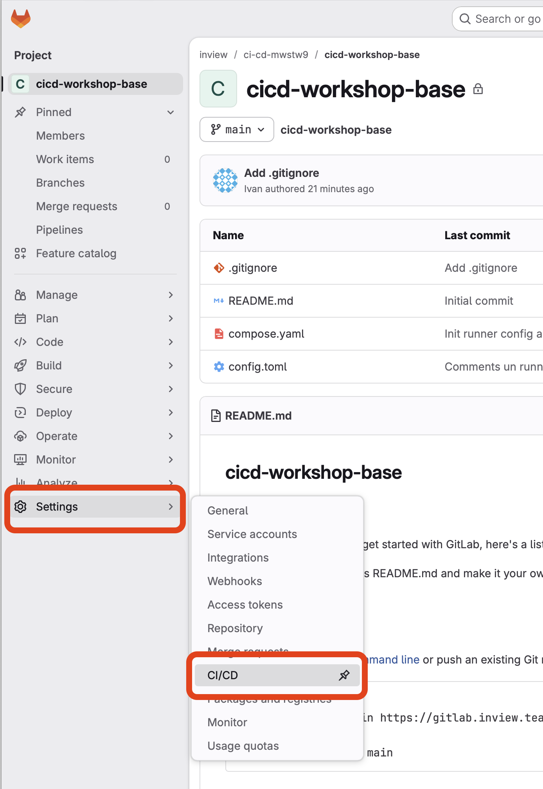
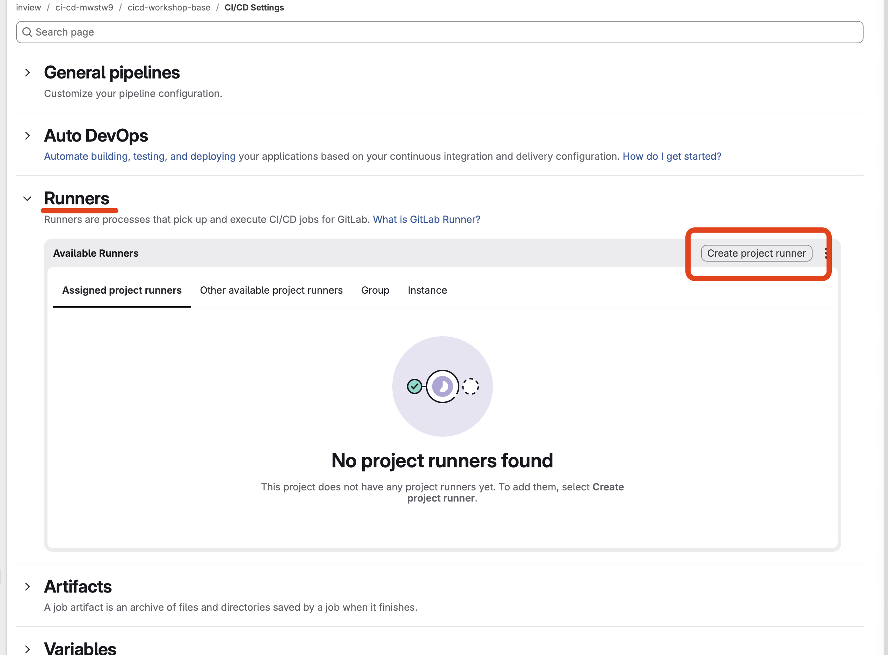
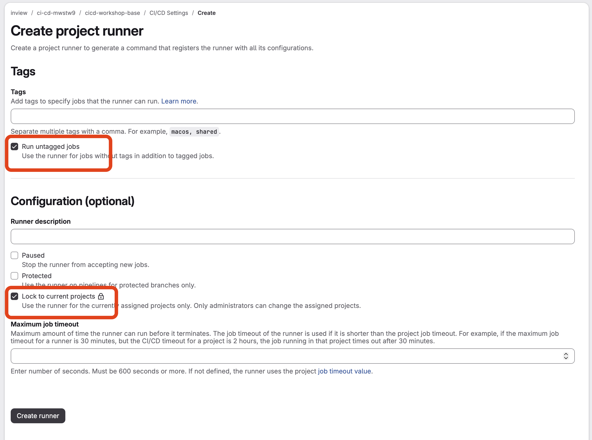
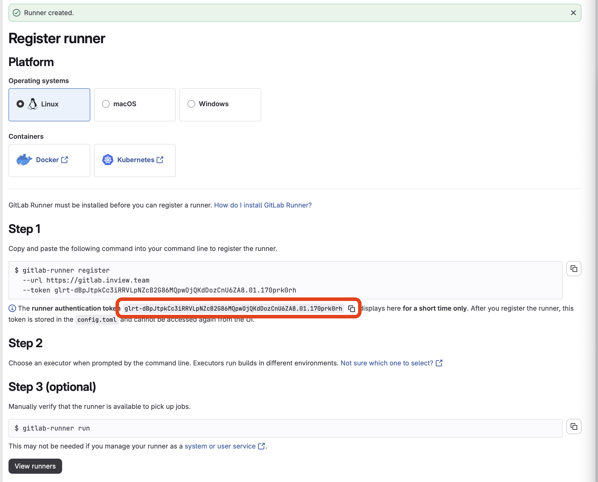
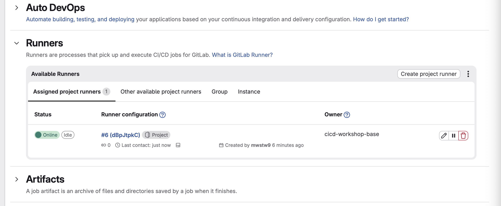
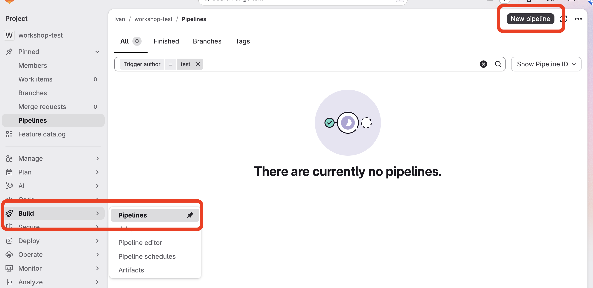
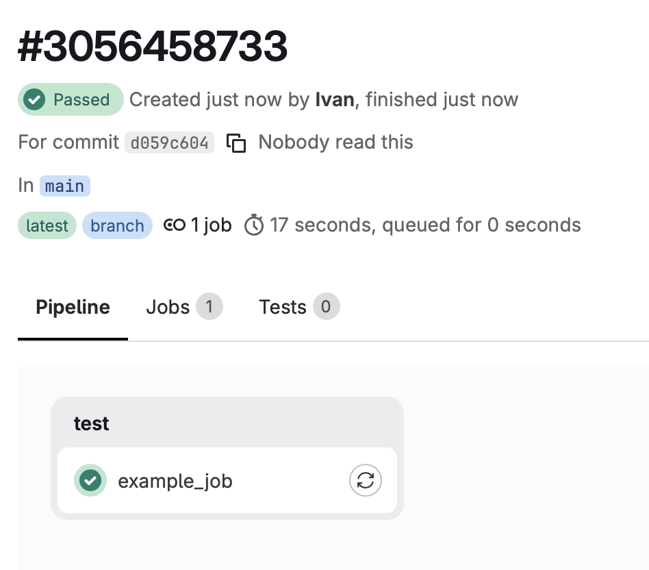

# Репозиторий базовой части воркшопа по CI/CD

Ниже можно найти:
- [Описание тестового проекта](#описание-тестового-проекта)
- [Задание 1. Регистрация GitLab Runner](#задание-1-регистрация-gitlab-runner)
- [Задание 2. Базовый Pipeline](#задание-2-базовый-pipeline)
- [Задание 3. Проверка качества кода](#задание-3-проверка-качества-кода)
- [Задание 4. Артефакты и деплой](#задание-4-артефакты-и-деплой)

## Описание тестового проекта

В репозитории находится небольшое приложение на Go, которое вычисляет статистику по числам, переданным через аргументы командной строки.

В рамках практической части воркшопа вам предстоит самостоятельно настроить GitLab CI/CD Pipeline для тестирования, сборки и запуска этого приложения.

Исходный код приложения находится в корне репозитория.

Ниже приведены основные команды, которые понадобятся для выполнения заданий.

### 1. Требования

Для работы с приложением потребуется Go. В GitLab CI/CD можно использовать Docker-образ `golang:1.25-alpine`.

### 2. Запуск тестов

В проекте есть тесты для проверки корректности работы приложения.

Для их запуска выполните команду:

```bash
go test ./...
```

При успешном выполнении все тесты завершатся без ошибок. Если какой-то тест не пройдёт, команда вернёт ненулевой код завершения.

### 3. Сборка приложения

Для сборки приложения выполните команду:

```bash
go build -o stats .
```

В результате в корне репозитория появится бинарник `stats`.

### 4. Запуск приложения

Собранное приложение принимает целые числа в качестве аргументов и выводит рассчитанную статистику.

Пример использования:

```bash
./stats 10 20 30 40
```

Приложение выведет количество чисел, их сумму, минимальное и максимальное значения, а также среднее арифметическое.

### 5. Проверка форматирования

Для проверки форматирования исходного кода используется стандартная утилита Go — `gofmt`.

Чтобы проверить форматирование файлов, выполните из корня репозитория команду:

```bash
test -z "$(gofmt -l .)"
```

Команда работает следующим образом:
- `gofmt -l .` — выводит список неправильно отформатированных Go-файлов.
- `test -z` — проверяет, что полученный список пуст.

Если все файлы отформатированы правильно, команда завершится с кодом `0`. Если найдены ошибки форматирования — с кодом `1`.

Чтобы посмотреть, какие именно файлы содержат ошибки форматирования, используйте:

```bash
gofmt -l .
```

**ВАЖНО:** В исходном коде проекта специально допущены ошибки форматирования. Это понадобится для выполнения практического задания по GitLab CI/CD.

## Задание 1. Регистрация GitLab Runner

Для воркшопа понадобится GitLab Runner, запущенный на вашем устройстве в Docker-контейнере.  
В качестве executor будет выступать Docker.

### 1. Проверка Docker

Убедитесь, что на устройстве запущен и работает Docker.  
Для проверки можете ввести команду `docker info`.

### 2. Создание Runner в GitLab

Откройте в GitLab свой форк этого проекта и перейдите в **Settings -> CI/CD**.



Здесь нужно раскрыть вкладку **Runners** и нажать **Create project runner** для создания нового Runner.



После этого вы окажетесь на странице создания Runner.



**⚠️ ВАЖНО ⚠️**

На этом этапе обязательно установите следующие флажки:
- **Run untagged jobs**
- **Lock to current projects**

Первый флажок нужен для работы практической части, второй не позволяет использовать Runner в других репозиториях.

Остальные поля можно оставить без изменений, но при желании вы можете заполнить описание.

Установив флажки, нажмите **Create runner**. На следующей странице надо скопировать токен и вставить его в [config.toml](./config.toml) в параметр **token**.

Остальные пункты на странице не важны.



### 3. Запуск Runner

Для запуска Runner надо в корне репозитория выполнить команду:

```bash
docker compose up -d
```

Она запустит контейнер с Runner.

При успешном выполнении всех шагов Runner спустя небольшой промежуток времени перейдёт в статус **online**.  
Это можно проверить на вкладке **Settings -> CI/CD -> Runners**.



### 4. Проверка работы

В репозитории уже находится рабочий пайплайн.
Запустим его для проверки успешности предыдущих шагов.

Для этого перейдите во вкладку **Build -> Pipelines** и тыкните **New pipeline** (в левом верхнем углу).



В открывшейся странице ничего не трогаем, только снова тыкаем **New pipeline**. После этого должен запуститься пайплайн.  
Снизу на скриншоте показано, как должно быть при успешном добавлении runner.



### 5. Решение проблем

Если Runner не переходит в статус **online** или Pipeline зависает в **Pending**, проверьте настройки Runner в GitLab и правильность токена в файле [config.toml](./config.toml).

После исправления конфигурации перезапустите контейнер Runner из корня репозитория:

```bash
docker compose restart
```

Для просмотра логов Runner выполните:

```bash
docker compose logs --tail=100
```

## Задание 2. Базовый Pipeline

**Цель:** настроить автоматическое тестирование и сборку Go-приложения с помощью GitLab CI/CD.

В корне репозитория уже находится файл `.gitlab-ci.yml` с примером тестовой Job. Вам необходимо доработать его, добавив полноценные этапы тестирования и сборки приложения.

### Что необходимо сделать

1. Изучить инструкции по работе с Go-приложением в README.md.
2. Выбрать подходящий Docker-образ для выполнения Go-команд.
3. Добавить Job для тестирования приложения в Stage `test`.
4. Добавить Job для сборки приложения в Stage `build`.
5. Отправить изменения в GitLab и проверить выполнение Pipeline.

### Ожидаемый результат

**Готово, если:**

- Pipeline автоматически запускает тестирование и сборку Go-приложения.
- Тестирование и сборка выполняются в отдельных Jobs и соответствующих Stages.
- Сборка начинается после успешного завершения тестирования.
- Pipeline успешно выполняется на вашем GitLab Runner.

## Задание 3. Проверка качества кода

**Цель:** дополнить Pipeline проверкой форматирования, разобраться с обработкой ошибок Jobs и переменными CI/CD.

В проекте намеренно оставлены ошибки форматирования Go-кода. Необходимо добавить автоматическую проверку, которая обнаружит эти ошибки, но не будет блокировать сборку приложения.

### Что необходимо сделать

1. Добавить Job проверки форматирования Go-кода в Stage `test`.
2. Запустить Pipeline и убедиться, что новая Job завершается с ошибкой.
3. Настроить `allow_failure`, чтобы ошибка форматирования не приводила к провалу всего Pipeline.
4. Создать глобальную переменную `BUILD_PATH`, определяющую путь к собираемому бинарнику.
5. Использовать `BUILD_PATH` в Job сборки и проверить работу Pipeline.

**Дополнительно:** исправить форматирование исходного кода и убедиться, что проверка проходит успешно.

### Ожидаемый результат

**Готово, если:**

- Pipeline автоматически проверяет форматирование Go-кода.
- Ошибка форматирования отображается как предупреждение и не блокирует сборку.
- Путь к результату сборки задаётся через глобальную переменную `BUILD_PATH`.
- Pipeline завершается успешно, несмотря на ошибку проверки форматирования.

## Задание 4. Артефакты и деплой

**Цель:** научиться сохранять результат сборки, передавать его между Jobs и управлять условиями запуска.

На предыдущих этапах приложение успешно собиралось, но собранный бинарник не сохранялся для последующих Jobs. Теперь необходимо передать его в отдельную Job и настроить запуск в зависимости от ветки.

### Что необходимо сделать

1. Добавить сохранение бинарника через `artifacts` в Job сборки.
2. Добавить Stage `deploy` и Job для запуска собранного приложения.
3. Использовать переменную `BUILD_PATH` для запуска полученного бинарника.
4. Настроить `rules`: ручной запуск в основной ветке и автоматический — в остальных ветках.
5. Отправить изменения в GitLab и проверить поведение Pipeline в разных ветках.

### Ожидаемый результат

**Готово, если:**

- Собранный бинарник сохраняется как артефакт и доступен в следующей Job.
- Приложение запускается из сохранённого артефакта без повторной сборки.
- В основной ветке запуск приложения требует ручного подтверждения, а в остальных ветках выполняется автоматически.

*В этом задании «деплой» учебный: приложение запускается внутри Job, а не развёртывается на отдельном сервере.*
