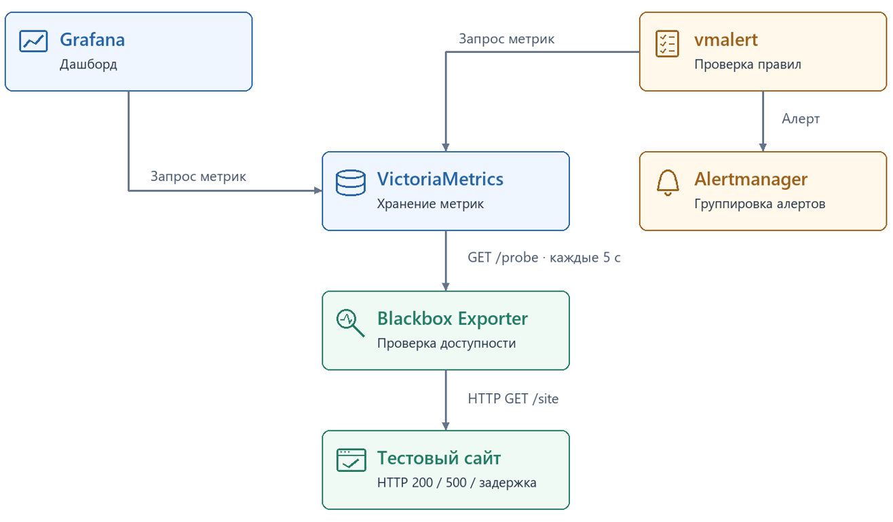
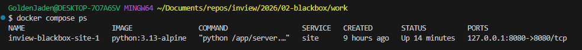
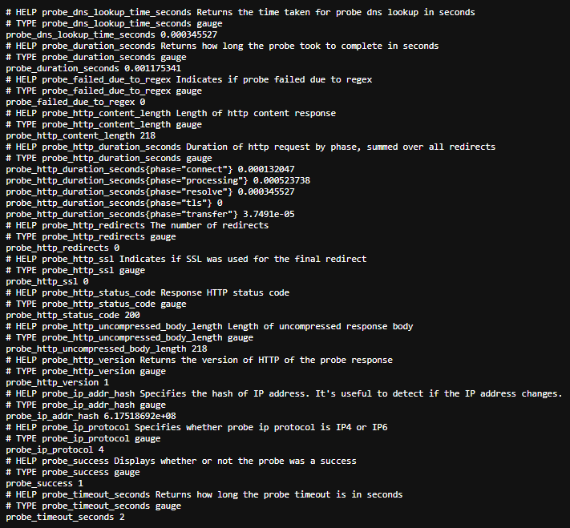
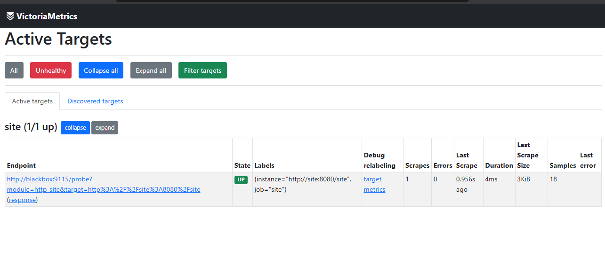
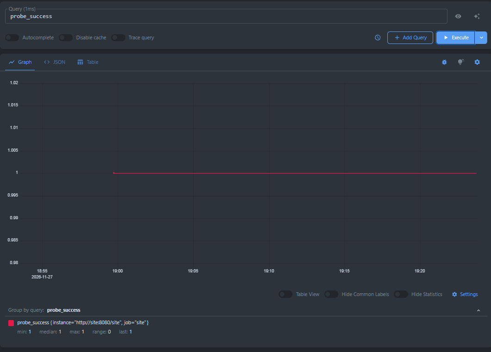
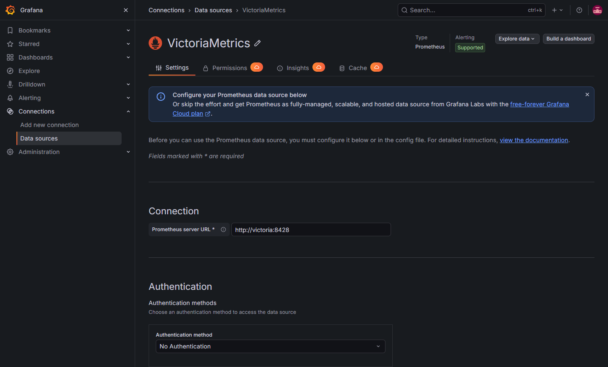
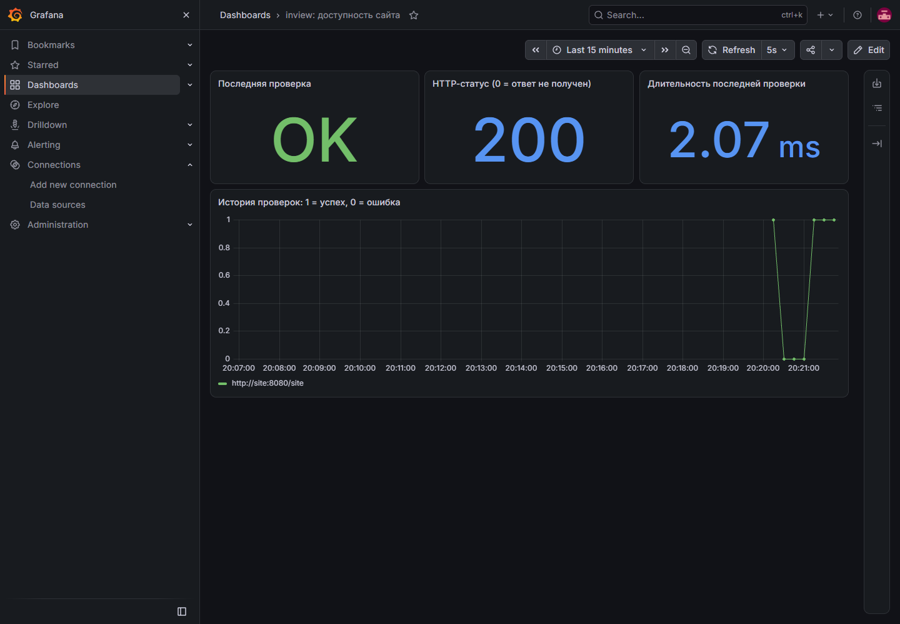
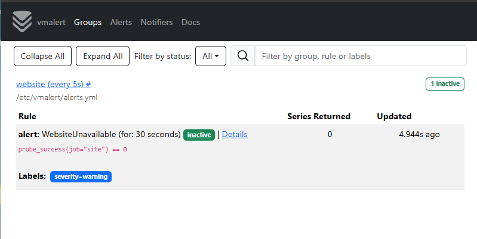
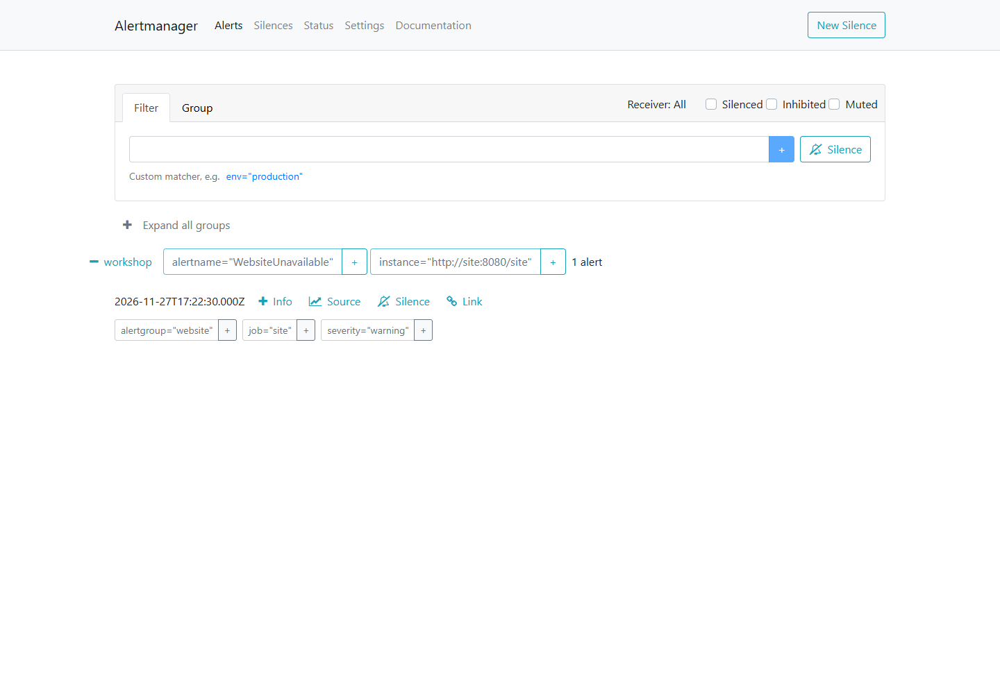

# Пошаговая инструкция



Воркшоп: **Мониторинг доступности сервиса**

- [0. Начало](#0-начало)
- [1. Запуск тестового сайта](#1-запуск-тестового-сайта)
- [2. Развертывание Blackbox Exporter](#2-развертывание-blackbox-exporter)
- [3. Развертывание VictoriaMetrics](#3-развертывание-victoriametrics)
- [4. Развертывание Grafana](#4-развертывание-grafana)
- [5. Алертинг: vmalert и Alertmanager](#5-алертинг-vmalert-и-alertmanager)
- [6. Проверка ошибок и задержек](#6-проверка-ошибок-и-задержек)
- [7. Дополнительные активности](#7-дополнительные-активности)
- [Очистка окружения](#очистка-окружения)

## 0. Начало

Сегодня настроим мониторинг сайта: будем проверять его доступность, время и код ответа.

Наш стек:

- **Тестовый HTTP-сервис**;
- **Blackbox Exporter** - Мониторинг доступности сервиса;
- **VictoriaMetrics** - Хранилище метрик;
- **vmalert и Alertmanager** - Создание и отправка алертов;
- **Grafana** - Визуализация метрик.

Все сервисы будем запускать локально с помощью Docker compose.

Откройте терминал в каталоге этой практики. Все команды выполняем в `work/`:

```sh
cd work
docker compose version
```

## 1. Запуск тестового сайта

Начнём с запуска тестового HTTP-сервиса

```sh
docker compose up -d site
```

Посмотреть список запущенных контейнеров можно с помощью команды:

```sh
docker compose ps
```



Откройте http://localhost:8080. Это панель управления учебным сервисом. Оставьте режим **«HTTP 200»** и нажмите **«Открыть сайт»**, чтобы перейти на http://localhost:8080/site.

Ожидаемый результат: надпись **«Сервис здоров»**, HTTP 200. 

Представим, что `/site` предоставляет какой-то очень важный функционал. Его мы и будем мониторить.

## 2. Развертывание Blackbox Exporter

Представьте ситуацию: на дашборде всё хорошо: метрики показывают, что сервис работает, ресурсов хватает, есть какие-то запросы. При этом пользователь обращается к сервису и получает ошибку. Внутренние метрики полезны для диагностики, но сами по себе не гарантируют, что сервис доступен пользователю.

Поэтому проверим наш сервис со стороны клиентского пути: отправим запрос и посмотрим, какой ответ придёт и сколько времени он займёт. Это будет делать **Blackbox Exporter**. Ему достаточно адреса сервиса — он обращается к нему по HTTP и отдаёт результат проверки в виде метрик. Такой способ мониторинга называют "Black Box" (Чёрный Ящик): как работает сервис под капотом нас не интересует - **важен только результат**.

Настройки проверки в Blackbox объединяются в модули: в них указывают протокол, время ожидания и условия успешного ответа. Создадим свой модуль для HTTP.

Откройте `blackbox/blackbox.yml` и замените содержимое:

```yaml
modules:
  http_site:
    prober: http
    timeout: 2s
    http:
      method: GET
      preferred_ip_protocol: ip4
```

`http_site` - произвольное название модуля. Он отправляет GET-запрос и ждёт ответ не больше двух секунд. По умолчанию успешными считаются ответы с кодом 2xx — например, HTTP 200. Если сайт вернёт ошибку или не успеет ответить за 2 секунды, проверка будет неуспешной.

Запустим мониторинг:

```sh
docker compose up -d blackbox
```

Теперь запустим первую проверку вручную. В ссылке передадим адрес сайта (`target`) и название нашего модуля (`module`). Перейдите по:

http://localhost:9115/probe?target=http%3A%2F%2Fsite%3A8080%2Fsite&module=http_site

Вы увидите метрики результата запроса.



 Найдите эти две строки:

```text
probe_success 1
probe_http_status_code 200
```

`probe_success 1` означает, что проверка прошла успешно, а `probe_http_status_code 200` — что сайт ответил HTTP 200. Также найдите `probe_duration_seconds`: это длительность проверки в секундах.

Теперь настроим регулярное выполнение проверки и сохранение результатов.

## 3. Развертывание VictoriaMetrics

Подключим **VictoriaMetrics** - хранилище метрик. Она будет каждые пять секунд обращаться к Blackbox и сохранять полученные метрики.

Откройте `victoria/scrape.yml`. Сохраните блок `global`, а строку `scrape_configs: []` замените следующим блоком:

```yaml
scrape_configs:
  - job_name: site
    metrics_path: /probe
    params:
      module: [http_site]
      target: [http://site:8080/site]
    static_configs:
      - targets: [blackbox:9115]
        labels:
          instance: http://site:8080/site
```

Из этого конфига соберётся такая ссылка для скрейпа: `http://blackbox:9115/probe?module=http_site&target=http://site:8080/site`

Запускаем:

```sh
docker compose up -d victoria
```

Откройте http://localhost:8428/targets. Должен появиться таргет с состоянием **UP**. Подождите 5–10 секунд, если данные ещё не появились.



В интерфейсе запросов VictoriaMetrics http://localhost:8428/vmui/ выполните запрос:

```promql
probe_success
```

И увидите динамику изменения метрики



Хотя и визуализация данных здесь достаточно неплохая, но её может быть недостаточно, особенно, если нужно анализировать множество метрик одновременно.

Поэтому сейчас мы поднимем инструмент, который поможет нам строить многофункциональные дашборды и визуализации.

## 4. Развертывание Grafana

**Grafana** будет запрашивать данные из VictoriaMetrics и показывать их на графиках.

### Подключение источника

Запускаем:

```sh
docker compose up -d grafana
```

Переходим на http://localhost:3000.

Первый вход: `admin` / `admin`. Grafana предложит изменить данные входа: ставим снова `admin` / `admin`, чтобы потом не забыть креды =)

В левом боковом меню откройте **Connections → Data sources**. Нажимаем "Add data source" и выбираем **Prometheus**. Далее Вам необходимо заполнить только лишь поле "Prometheus server URL": http://victoria:8428.

В списке мы выбрали тип **Prometheus**, потому что VictoriaMetrics поддерживает тот же API для запросов. Grafana умеет работать с ним через этот источник.



Нажмите **Save & test**. Grafana проверит соединение с VictoriaMetrics и покажет результат. Если подключение успешно, можно переходить созданию дашборда.

### Импорт дашборда

Откройте **Dashboards → New → Import** и загрузите файл `grafana/dashboard.json` из каталога `work/`.

При импорте в переменную DS_PROMETHEUS выберите созданный датасорс и нажмите **Import**.

На дашборде четыре панели:

- Успешность последней проверки;
- последний HTTP-статус;
- длительность проверки;
- история успешных и неуспешных проверок.



## 5. Алертинг: vmalert и Alertmanager

Дашборд помогает увидеть проблему, но постоянно смотреть на него никто не будет. Настроим алерт: если сайт некоторое время не проходит проверку, система должна сообщить об этом.

Для этого понадобятся ещё два компонента. **vmalert** читает метрики из VictoriaMetrics и проверяет заданные условия. Когда условие выполняется, он отправляет алерт в **Alertmanager**. Тот группирует алерты и направляет их настроенным получателям.

Откройте `vmalert/alerts.yml`. Там уже есть правило `WebsiteUnavailable`: оно проверяет, что `probe_success` равен `0` в течение 30 секунд.

Чтобы правило работало, vmalert должен знать, откуда брать метрики и куда отправлять алерты. В Compose это задано двумя параметрами:

```text
-datasource.url=http://victoria:8428
-notifier.url=http://alertmanager:9093
```

`-datasource.url` указывает на VictoriaMetrics, а `-notifier.url` — на Alertmanager.

Запустите оба сервиса:

```sh
docker compose up -d alertmanager vmalert
```

Откройте vmalert: http://localhost:8880/vmalert/groups — здесь можно посмотреть правило и его текущее состояние. Затем откройте alertmanager: http://localhost:9093 — здесь появятся алерты, которые получил Alertmanager. Пока активных алертов быть не должно.



В `alertmanager/alertmanager.yml` уже настроен получатель `workshop`. На воркшопе будем смотреть алерты в интерфейсе Alertmanager. Чтобы получать их, например, на почту, нужно дополнительно настроить канал уведомлений.

## 6. Проверка

Всё готово: сайт проверяется, метрики сохраняются, правило алерта настроено. Теперь посмотрим, как система реагирует на ошибки и задержки. Откройте рядом панель сайта http://localhost:8080 и дашборд Grafana.

### HTTP 500

В панели управления нажмите **«HTTP 500»**. Подождите 5–10 секунд.

Ожидаемый результа на дашборде:

- HTTP-статус — `500`;
- успех проверки — `0` (`FAIL`);

Откройте http://localhost:8880/vmalert/groups и найдите `WebsiteUnavailable`. Сначала появится состояние **Pending**: vmalert уже видит ошибку, но ждёт, сохранится ли она в течение 30 секунд. Затем правило перейдёт в **Firing** — алерт сработал.

На http://localhost:9093 появится `WebsiteUnavailable`: значит, vmalert передал алерт в Alertmanager.



Верните **«HTTP 200»**. На дашборде снова появится **OK**, а правило перейдёт в **Inactive**: условие ошибки больше не выполняется. Подождите до минуты и убедитесь, что в Alertmanager алерт тоже исчез из активных.

### Медленный ответ: 1 секунда

Включите **«Медленный ответ: 1 секунда»**.

Посмотрите на длительность проверки: теперь она составляет примерно секунду. При этом статус остаётся **OK**, а код ответа — **200**. Сайт стал медленнее, но всё ещё укладывается в заданные две секунды. Алерт должен закрыться и исчезнуть из alertmanager.

### Медленный ответ: 4 секунды

Включите **«Медленный ответ: 4 секунды»**.

При ответе сайта больше двух секунд мы так же должны получить алерт.

## 7. Дополнительные активности

Если осталось время, выберите одно задание:

1. **Увеличить таймаут.** В `blackbox/blackbox.yml` замените `timeout: 2s` на `timeout: 4.5s`, выполните `docker compose restart blackbox`. Проверьте режим четырёхсекундной задержки.
2. **Изменить критерий успеха.** В блок `http` добавьте `valid_status_codes: [200, 500]`, перезапустите Blackbox и проверьте HTTP 500.

## Если что-то не работает

Первым делом посмотрите логи контейнеров, чтобы понять ошибку:

```sh
docker compose ps
docker compose logs site blackbox victoria grafana vmalert alertmanager
```

## Очистка окружения

Когда закончите практику, остановите и удалите контейнеры и очистите вольюмы.

```sh
docker compose down -v
```

## Дополнительные материалы

- [Blackbox Exporter](https://github.com/prometheus/blackbox_exporter)
- [Настройка HTTP-модулей](https://github.com/prometheus/blackbox_exporter/blob/master/CONFIGURATION.md)
- [Multi-target exporter pattern](https://prometheus.io/docs/guides/multi-target-exporter/)
- [VictoriaMetrics](https://docs.victoriametrics.com/victoriametrics/single-server-victoriametrics/)
- [vmalert](https://docs.victoriametrics.com/victoriametrics/vmalert/)
- [Alertmanager](https://prometheus.io/docs/alerting/latest/alertmanager/)
- [Подключение Prometheus к Grafana](https://grafana.com/docs/grafana/latest/datasources/prometheus/configure/)
